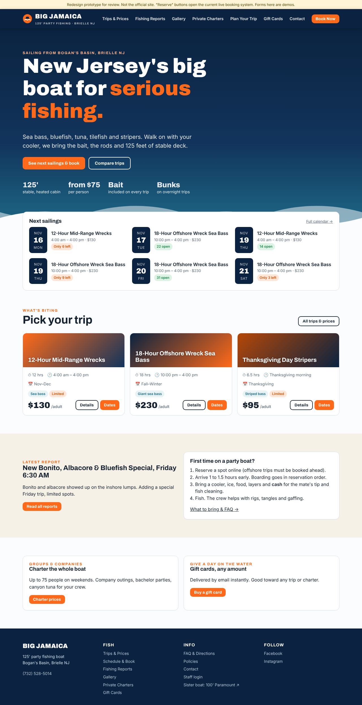

# Big Jamaica website (redesign)

New website for the 125' Big Jamaica party fishing boat, Brielle NJ.

- `index.html` is the public site. Open it in a browser, no build step.
- `admin.html` is the staff admin for schedule, fishing reports, photos and prices. It's a prototype that saves to browser storage.
- `content.js` holds the default content (trips, prices, sailings, reports, charters, photos).
- `HANDOFF.md` covers feature parity with the current site, what the current booking developer must provide, and open holes.

Booking stays on the current system: "Reserve" buttons deep-link to `bigjamaica.com/booknow/<trip>`.

